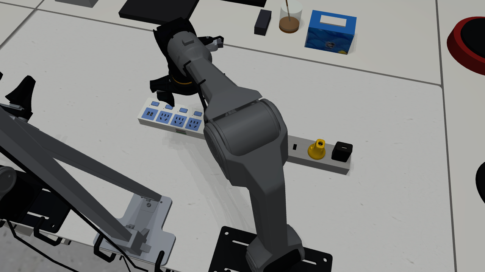

# Piper 双臂仿真场景

本分支只保留插接场景的代码、模型资源、最终配置和采集入口。**真实失败翻转与掉落未复现到要求精度，本轮任务失败。**

已删除大数据Release。旧调参结果、重复原始帧、调试录像和环境副本不再上传；原始真机采集留在本机。



## 使用

```bash
git clone --branch codex/failed-sim-real-archive-20261111 https://github.com/Adeline123456789/piper_sim.git
cd piper_sim
python3.11 -m venv .venv-mujoco
.venv-mujoco/bin/python -m pip install -e '.[mujoco,recorded-scenes,mixed-recording]'
bash scripts/run_mujoco.sh --task-scene configs/tasks/real_connector_final.yaml --interactive --enable_cameras
```

- [运行与采集方法](docs/ARCHIVE_AND_COLLECTION.md)
- [未解决的问题](docs/FAILURE_REPORT.md)
- [其他场景及原项目说明](README_PRE_ARCHIVE.md)

每臂6个旋转关节和1个夹爪开合控制通道；MuJoCo3.3.7。灰座170×60×33mm，白排212×76×30mm，黄色插头实测40.9g，夹爪内侧硬质橡胶。模型在assets/，最终配置在configs/tasks/real_connector_final.yaml，相机参数随仓库保存。

摩擦、COM、惯量及接触模型仍有估计值，不能宣称训练后直接部署真机。没有六维力/力矩传感器；SDK effort未标定，不能当实测力矩。仿真计算力也不等于实物测量。
